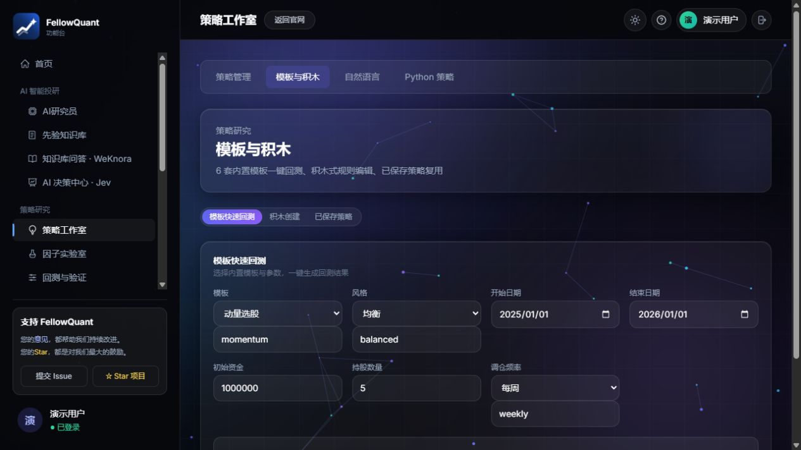

<p align="center">
  
</p>

<h1 align="center">FellowQuant · 智投引擎</h1>

<p align="center">从投资想法，到可验证的量化研究。</p>

<p align="center">
  <a href="README.md"><strong>简体中文</strong></a> · <a href="README.en.md">English</a>
</p>

<p align="center">
  
  
  
  <a href="LICENSE"></a>
</p>

## 🖥️ 实际界面

以下截图来自本项目运行页面，使用隔离的演示账户；未配置外部服务的结果会标明演示模式。

**品牌首页**


**功能台：精简导航与策略工作室**



## 📖 项目介绍

FellowQuant v4 是面向 A 股的量化研究工作台，基于 **Vue 3 + FastAPI** 构建。它把数据更新、策略创建、因子评估、回测验证和 AI 投研放进同一套工作流程，帮助研究者记录和检验投资想法。

v4 延续 AlphaQuant 的量化研究能力，并采用独立前后端架构。策略研究侧栏收敛为四个入口，详细操作在页内切换，减少寻找功能的成本。

| 工作区 | 功能 |
| --- | --- |
| AI 智能投研 | AI研究员：用本地数据整理一只股票的走势、估值、财报和风险，再由平台的 AI 模型只根据这些数据写解读；保存每次分析，并对照之后的实际涨跌 |
| 我的策略 | 规则策略列表；新建规则策略可以从模板开始、用一句话描述或自己填表单，不用写代码 |
| 因子研究 | 因子库、单因子评估、组合研究；新建因子与高级合成评估保留页内入口 |
| 回测与验证 | 策略回测、参数优化、样本外验证；风险设置在配置区、审计附于结果、成交核查收入高级工具。优化与滚动验证目前为模拟预览 |
| 研究记录 | 历史研究结果与比较 |
| 数据管理 | 数据概览、数据更新、股票池管理；XTick 位于概览的「数据源与高级工具」 |
| 系统 | 个人中心、账户独立的服务配置 |

**能力边界：**回测与因子评估需要先下载行情数据；监控大屏使用模拟指标。文本 AI 需要服务器配置 `OPENROUTER_API_KEY` 或其他兼容服务，Jev 决策可单独使用 `TYPESAFE_API_KEY`，没有配置时不显示相应 AI 结果；WeKnora 文档问答需要独立部署的服务。项目用于研究与模拟，不连接真实资金交易。

## 🚀 快速开始

准备 Python 3.11+、Node.js 18+ 和 Git。

```bash
git clone --branch fellowquant_v4 https://github.com/FelixZhang028/AlphaQuant.git
cd AlphaQuant
```

**Windows**：在项目根目录运行 `start.bat`。首次运行会检查并安装必要依赖，启动后访问 `http://127.0.0.1:5273`。按任意键停止由脚本启动的服务。

**手动启动 / macOS / Linux**：

```bash
# 终端一：后端
cd dashboard/backend
python -m venv .venv
# macOS / Linux
source .venv/bin/activate
# Windows PowerShell 使用：.\.venv\Scripts\Activate.ps1
python -m pip install -r requirements.txt
python -m uvicorn app.main:app --host 127.0.0.1 --port 8000
```

```bash
# 终端二：从项目根目录进入官网/功能台
cd landing
npm ci
npm run dev -- --host 127.0.0.1
```

注册并登录后，先进入「数据管理 → 数据更新」，再创建策略、运行回测。接口文档位于 `http://127.0.0.1:8000/docs`。

独立管理后台与监控大屏可分别从 `admin/`、`dashboard/frontend/` 运行 `npm ci` 和 `npm run dev`，默认端口为 5175、5174。

## ⚙️ 可选配置

将 `dashboard/backend/.env.example` 复制为同目录的 `.env`，填写需要的配置；后端启动时自动读取。模型密钥由服务器统一配置；用户在页面保存的 WeKnora 配置优先于相应环境变量。`.env` 不进入 Git。

| 配置 | 用途 |
| --- | --- |
| `APP_SECRET` | 登录令牌签名；留空时自动生成并持久化本机随机密钥 |
| `FELLOWQUANT_ADMIN_EMAIL` / `FELLOWQUANT_ADMIN_PASSWORD` | 首次创建管理员，初始密码至少 12 位；不提供公共默认密码 |
| `OPENROUTER_API_KEY` | 平台统一提供的 AI 模型（AI研究员、用一句话生成规则），也用于 Jev 决策服务；用户不需要自己填写密钥 |
| `TYPESAFE_API_KEY` / `JEV_API_KEY` | TypeSafe 官方 Jev 密钥（前者优先）；配置后 Jev 独立于聊天模型，默认调用官方 `/v1/systemone`，未配置时使用 OpenRouter |
| `FELLOWQUANT_AI_MODEL` / `FELLOWQUANT_AI_BASE_URL` | 可选：换模型或换成其他 OpenAI 兼容服务（默认 OpenRouter 上的 `deepseek/deepseek-v4-pro`）；换服务时用 `FELLOWQUANT_AI_API_KEY` 填它的密钥 |
| `FELLOWQUANT_AI_DAILY_BRIEFS` / `_QUESTIONS` / `_STRATEGIES` / `_REVIEWS` | 可选：每人每天的 AI 分析、追问、生成规则、AI 评估次数（默认 5 / 20 / 10 / 10），管理员不限 |
| `FELLOWQUANT_JEV_MODEL` / `FELLOWQUANT_JEV_URL` | 可选：决策模型和完整接口地址；TypeSafe 默认 `jev-latest`，OpenRouter 默认 `typesafe/jev-1.13`。密钥必须与服务匹配 |
| `FELLOWQUANT_DAILY_UPDATE` / `FELLOWQUANT_DAILY_UPDATE_TIME` | 每个交易日收盘后自动更新全市场数据（默认开启，北京时间 18:30 以后）；填 `off` 关闭，管理员仍可在数据更新页手动运行 |
| `FELLOWQUANT_COMPUTE_SLOTS` / `_PER_USER` / `_TIMEOUT` / `_CACHE` | 耗时计算（回测、参数验证、因子评估与组合研究）的限制：全站同时最多几件（默认 CPU 核数的一半，2 到 4）、每人同时几件（默认 1）、一件最多多少秒（默认 600）、记住多少份因子研究结果（默认 64） |
| `WEKNORA_BASE_URL` / `WEKNORA_API_KEY` | WeKnora 服务地址与空间 Key，也可在页面配置 |
| `SMTP_HOST` / `SMTP_PORT` / `SMTP_FROM` | 密码重置邮件服务，采用 STARTTLS；默认端口 587 |
| `SMTP_USERNAME` / `SMTP_PASSWORD` | SMTP 登录凭据（邮件服务需要时填写） |

行情数据所有用户共用一份。后端运行时，每个交易日收盘后自动更新全市场：行情（含估值与换手率）、新上市股票的全部历史、分红送转记录、指数行情、指数成分股、行业分类和历史股票池。当天行情还没发布或更新没完成时，30 分钟后再试，最晚到 23:30。下载数据、补历史数据、查看后台任务和配置 XTick 只有管理员可以操作；普通用户在数据更新页看到更新状态。

所有用户共用一台服务器，耗时的计算有三条限制：每人同一时间只算一件，全站同时算的数量有上限（满了提示稍后再试），一件计算超过时间限制就停下。同样的因子评估或组合研究在同一份数据上算过就直接返回，数据每天更新以后重新计算。

未配置 SMTP 时密码重置不可用；验证码只发送至注册邮箱，不返回到浏览器。重置密码后旧登录令牌失效。本机账户、行情、运行记录和密钥保存在后端 `data/` 中，不进入 Git。

WeKnora 需要预先部署、创建知识库，并为 Key 开通相应的读取、检索和聊天权限。AI研究员的文字解读和“用一句话生成规则”使用平台的聊天模型；没有配置时，生成规则改用离线规则识别。决策模型 Jev 按概率回答选择、是非、评分三类问题：AI研究员可只使用 Jev 给出偏多/中性/偏空的概率，无需文本模型；回测结果页用它评估风险等级和过度拟合的可能。材料由平台从本地数据自动整理，结果按账户保存，重复打开不再计费；独立判断计入每日评估额度。TypeSafe 的请求协议见[官方文档](https://docs.typesafe.ai/api)。

需要验证实际集成时，在项目根目录运行 `python scripts/verify_jev.py --live`。该命令会向配置的 Jev 服务发送本地行情和回测摘要，消耗 API 额度；使用独立账户数据库，报告保存在 Git 忽略的 `outputs/`，不会修改现有账户和行情。

完整的配置、网页操作、API 示例、额度说明和故障排查见 [Jev 使用文档](docs/JEV_USAGE.md)。

## 🧩 项目结构

```text
.
├── landing/              # Vue 官网、登录、功能台与社区页面
├── admin/                # 独立管理后台
├── dashboard/
│   ├── frontend/         # 实时监控大屏
│   └── backend/
│       ├── app/          # FastAPI 路由、认证、数据库
│       ├── quant_platform/  # 量化研究、WeKnora 与 Jev 适配器
│       ├── trading_agents/  # AI 投研流程
│       ├── configs/      # 数据源、策略、风险配置
│       └── tests/        # 回归测试
├── docs/images/          # 实际页面截图
├── scripts/start.ps1    # Windows 服务启动与清理
└── start.bat
```

## 🧪 开发与验证

```bash
cd dashboard/backend
python -m pip install -r requirements-dev.txt
python -m pytest -q
python -m compileall -q app quant_platform trading_agents
```

在 `landing/`、`admin/`、`dashboard/frontend/` 各自执行 `npm ci`、`npm run build`。回归测试覆盖成交核查、外部服务协议、账户配置隔离、认证及密码重置；外部服务使用模拟响应，不产生模型费用。

## 🤝 参与贡献

欢迎通过 [Issue](https://github.com/FelixZhang028/AlphaQuant/issues) 反馈问题、提出功能建议，或提交 Pull Request。反馈时请说明复现步骤、预期行为和实际行为。

感谢 AlphaQuant 的量化研究基础，以及 [WeKnora](https://github.com/Tencent/WeKnora) 和 [OpenRouter](https://openrouter.ai/) 提供的集成能力。

## 📄 许可证

项目采用 [GNU GPL v3](LICENSE)。
